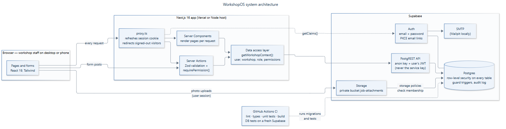
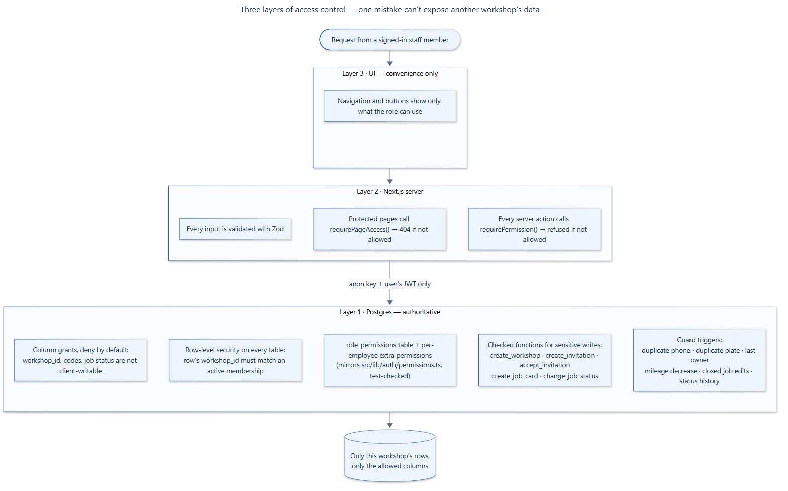
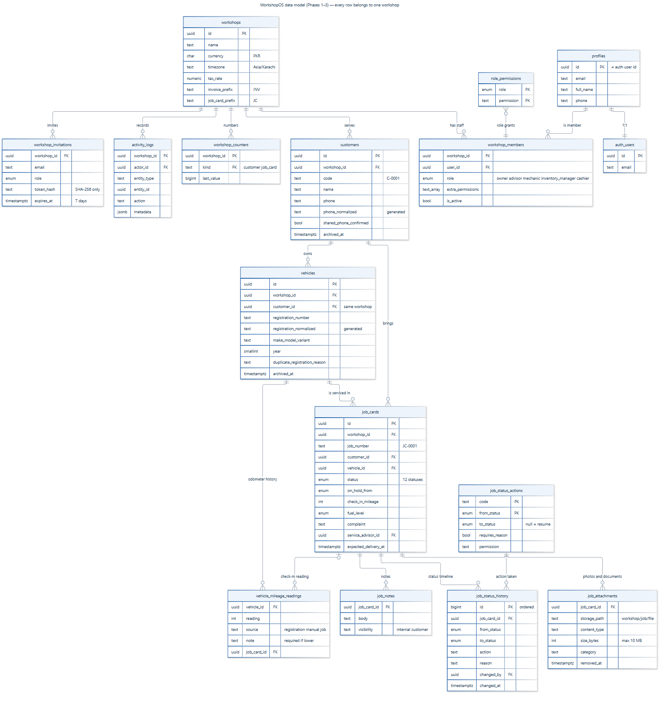

# Architecture

WorkshopOS is a multi-tenant web app: many workshops share one database, and the database itself
guarantees each workshop only ever sees its own rows.

## Stack

| Layer | Choice | Why |
| --- | --- | --- |
| UI | Next.js 16 App Router, React 19, Tailwind CSS 4 | Server-rendered pages, server actions for forms, one codebase |
| Validation | Zod 4 | Every form input is parsed on the server before it touches the database |
| Auth | Supabase Auth (email + password, PKCE email links) | Managed sessions, confirmation and reset emails |
| Database | Postgres via Supabase | Row-level security, triggers, functions |
| Files | Supabase Storage, private bucket `job-attachments` | Signed, expiring links only |
| Tests | Vitest — unit tests and database tests against a real local Supabase | The isolation rules are tested, not assumed |
| CI | GitHub Actions | Lint, types, unit tests, build, migrations + database tests on a fresh stack |

There is no ORM. ORMs connect to Postgres directly and bypass row-level security; the app instead talks
to Supabase's API with the anon key and the signed-in user's token, so every query is filtered by RLS.
The service-role key is used only by tests and the local seed script.

## Request lifecycle

1. **`src/proxy.ts`** (Next 16's name for middleware) refreshes the Supabase session cookie and sends
   signed-out visitors to `/login`. It is an optimistic check only.
2. **Pages** (Server Components) call the data access layer in `src/lib/auth/session.ts`:
   `getWorkshopContext()` returns the verified user, the active workshop, their role and permissions.
   Protected pages call `requirePageAccess(...)` and return 404 when the role can't use them.
3. **Server actions** (`actions.ts` next to each page) call `requirePermission(...)`, validate input with
   Zod, then call Supabase. Database errors are mapped to plain-language messages.
4. **Postgres** applies row-level security, column grants and guard triggers to every statement.

Next.js `cacheComponents` is switched off deliberately: every signed-in page renders fresh per request,
so there is no server cache that could serve one workshop's data to another.

## Multi-tenancy and access control

- Every business table has `workshop_id`. Child tables use **composite foreign keys**
  (`(workshop_id, parent_id) → parent(workshop_id, id)`), so a row can't point at another workshop's parent.
- RLS policies call `has_any_workshop_permission(workshop_id, [...])`, which checks the caller's active
  membership, their role's permissions (`role_permissions` table) and per-employee extra permissions.
- **Column grants are deny-by-default.** Clients can't write `workshop_id` on update, customer codes, job
  numbers or job status.
- **Sensitive writes go through checked functions** (`SECURITY DEFINER`, explicit permission checks):
  `create_workshop`, `create_invitation`, `accept_invitation`, `create_job_card`, `change_job_status`,
  `start_inspection`, `complete_inspection`, `create_estimate`, `send_estimate`, `record_estimate_decision`,
  `update_task_status`, `create_tasks_from_estimate`.
- **Narrow read functions for mechanics**: `my_assigned_jobs` and `get_assigned_job` return only what a
  mechanic needs for jobs they're assigned to — no prices, no customer contact details — so mechanics
  never get read access to customers, estimates or the priced catalogue.
- **Public, token-based functions** (no login): `get_invitation`, `get_estimate_for_customer`,
  `respond_to_estimate`. Tokens are 256-bit random; only SHA-256 hashes are stored; each returns the
  minimum data the page needs.
- **System-driven status moves**: inspection, estimate, approval and task functions move the job themselves;
  those moves carry the permission `system`, which no one holds, so no button can fake them.
- **Guard triggers** enforce business rules for every client: duplicate phones and plates, the last
  active owner, mileage that goes backwards, edits to closed job cards, job and task status history,
  and quality check while tasks are still open.
- The active workshop is chosen by an `active_workshop` cookie, but membership is re-verified on every
  request; the cookie is only a preference.

## Data model

Migrations live in `supabase/migrations/`, one per phase. Generated TypeScript types are in
`src/lib/supabase/database.types.ts` (`npm run db:types`).

Conventions:

- UUID primary keys; money will use `numeric` (never floating point).
- Timestamps are stored in UTC and shown in the workshop's time zone (`src/lib/format.ts`,
  `src/lib/datetime.ts` for `datetime-local` inputs).
- Nothing is hard-deleted from the UI. Customers and vehicles are archived (owner only); attachments are
  marked removed; history tables are append-only.
- Per-workshop numbering (C-0001, JC-0001, later INV-0001) uses `workshop_counters` via
  `next_workshop_number()`, inside the same transaction as the insert, so rejected saves don't burn numbers.

## Audit trail

`activity_logs` records every significant change: who, what, when, and a small JSON payload. Writes come
from database triggers (`audit_record_change`, `record_job_status_change`, member guards) and checked
functions, so the log can't be skipped by a client. Owners and advisors can read it at `/activity`.

## Local development

See the main [README](../README.md#run-it-locally). Local Supabase runs on ports 553xx so it can coexist
with other Supabase projects. `npm run db:seed-dev` creates test accounts.

## Testing strategy

| Suite | Command | Covers |
| --- | --- | --- |
| Unit | `npm test` | Permission matrix, validation schemas, normalisers, time zones, navigation |
| Database | `npm run test:rls` | Tenant isolation, roles, duplicate rules, job status history — against a real database |
| Manual | browser | Each phase's flows are exercised in the browser before the phase is called done |

Each phase has a **gate** — a property that must hold before the next phase starts — and a database test
that proves it:

| Phase | Gate | Test file |
| --- | --- | --- |
| 1 | Row-level security verified across two workshops | `tests/rls/tenant-isolation.test.ts` |
| 2 | A duplicate phone number is caught before save | `tests/rls/customers-vehicles.test.ts` |
| 3 | Every status change is timestamped | `tests/rls/job-cards.test.ts` |
| 4 | A revised estimate needs fresh approval | `tests/rls/estimates.test.ts` |
| 5 | A blocked task always records a reason | `tests/rls/tasks.test.ts` |
