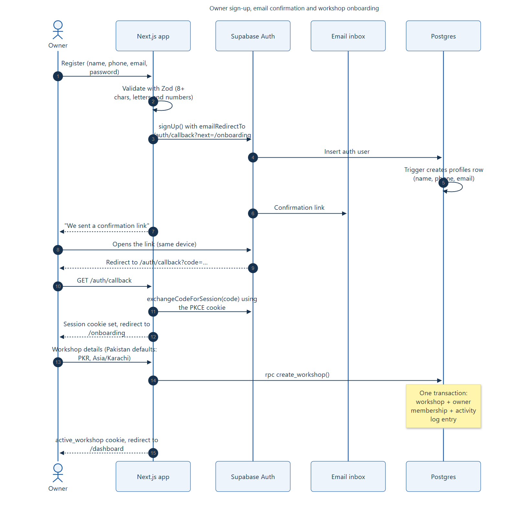

# 01 · Authentication

**Phase 1 · Built**

## What it does

Lets workshop owners and staff create an account, confirm their email, log in, log out and reset a
forgotten password. Signed-out visitors can only see the landing page, auth pages and invite links.

## Who can use it

Anyone. Every other feature requires a signed-in user.

## Screens

| Route | Purpose |
| --- | --- |
| `/` | Landing page; signed-in users are sent to `/dashboard` |
| `/register` | Create an account (name, phone, email, password) |
| `/login` | Log in; honours `?next=` to return to where the user was going |
| `/forgot-password` | Request a reset link |
| `/reset-password` | Choose a new password (reached from the emailed link) |
| `/auth/callback` | Landing point for confirmation and reset links |

## How it works

1. **Register.** The server action validates input, then calls Supabase `signUp()` with the name and
   phone as user metadata and a redirect to `/auth/callback?next=/onboarding` (or the invite page).
2. A database trigger (`handle_new_user`) creates a `profiles` row from the auth user.
3. **Confirm.** Email confirmation is on (locally, emails land in Mailpit at http://127.0.0.1:55324).
   The link returns a one-time `code`; `/auth/callback` exchanges it for a session using the PKCE
   verifier cookie, so the link only works in the browser that registered.
4. **Log in** with email and password; the session lives in HTTP-only cookies managed by `@supabase/ssr`.
5. **Proxy.** `src/proxy.ts` refreshes the session on every request and redirects signed-out visitors
   from app pages to `/login?next=…`.
6. **Reset.** `/forgot-password` always shows the same message whether or not the email exists, so
   accounts can't be probed. The emailed link signs the user in for `/reset-password` only.

## Rules

- Password: 8–72 characters, at least one letter and one number (enforced by Zod and by Supabase Auth
  `minimum_password_length = 8`, `password_requirements = letters_digits`).
- Phone: 7–20 digits with optional `+`, spaces, dashes.
- `next` redirects must be same-site relative paths (`safeNext()` rejects `//evil.com`, `https://…`).
- Login errors don't reveal whether the email exists ("Incorrect email or password"), except the
  explicit "please confirm your email first".

## Data

- `auth.users` (Supabase) — credentials.
- `profiles` — `id` (= auth user id), `email`, `full_name`, `phone`. Email is kept in sync by
  `handle_user_email_change`.

## Security

- The app never sees or stores passwords; Supabase Auth hashes them.
- Session cookies are HTTP-only; responses that set them carry no-cache headers so a CDN can't serve one
  user's session to another.
- Pages and actions re-verify the user with `supabase.auth.getUser()` (`getUser()` in `session.ts`); the
  proxy check is only a convenience.

## Code

`src/app/(auth)/` (pages and `actions.ts`), `src/app/auth/callback/route.ts`, `src/proxy.ts`,
`src/lib/supabase/proxy.ts`, `src/lib/auth/session.ts`, `src/lib/forms.ts`.

## Tests

`src/lib/forms.test.ts` (password rules, safe redirects). Sign-up, confirmation, login, wrong password,
logout and reset were verified in the browser.

## Not yet built

- Sign-in with Google or other providers.
- Phone/SMS login (common in Pakistan; needs an SMS provider).
- Editing your own name and phone after sign-up.
