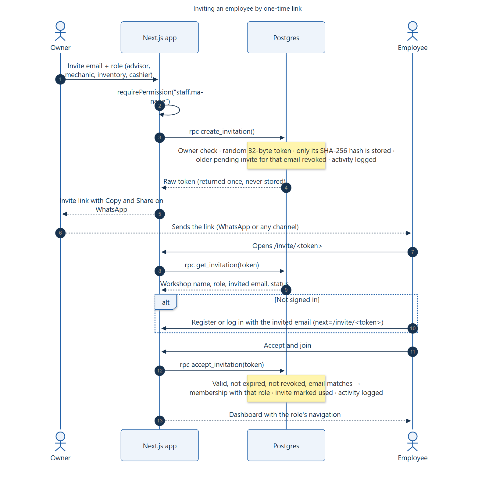

# 04 · Employees and invitations

**Phase 1 · Built**

## What it does

The owner invites staff with a one-time link (shareable on WhatsApp), changes their role, grants extra
permissions, and deactivates or reactivates accounts.

## Who can use it

Users with `staff.manage` — owners only.

## Screens

| Route | Purpose |
| --- | --- |
| `/employees` | Invite form, pending invites (with Revoke), team list with a Manage panel per person |
| `/invite/[token]` | Public page an invitee opens; shows workshop, role and invited email |

## How it works

1. The owner enters an email and a role (advisor, mechanic, inventory manager or cashier).
2. `rpc create_invitation()` checks the caller is an owner, refuses emails that are already active
   members, revokes any older pending invite for that email, generates a random 32-byte token and stores
   **only its SHA-256 hash**. The raw token is returned once and shown as a link with **Copy** and
   **Share on WhatsApp** buttons. It is never stored or shown again.
3. The invitee opens the link. `rpc get_invitation()` shows the workshop name, role, invited email and
   status (pending, accepted, revoked or expired).
4. If signed out, they register or log in **with the invited email**; `next` brings them back.
5. `rpc accept_invitation()` re-checks validity, expiry and that the signed-in email matches, then
   creates (or reactivates) the membership with that role and marks the invite used.
6. In **Manage**, the owner can change role, tick extra permissions, or deactivate/reactivate. Every
   change is logged.

## Rules

- Invites expire after 7 days and work once.
- An invite for the same email replaces the previous pending one.
- Owners can't invite owners; promote an existing member instead.
- The last active owner can't be demoted or deactivated.
- The owner's own row has no Manage panel (prevents accidental self-lockout).

## Data

- `workshop_invitations`: `email`, `role`, `token_hash`, `invited_by`, `expires_at`, `accepted_at`,
  `accepted_by`, `revoked_at`.
- `workshop_members`: see [roles and permissions](03-roles-and-permissions.md).

## Security

- Tokens are unguessable (256 bits); only hashes are stored, so a database leak doesn't expose live links.
- Accepting requires the invitee's verified email to match.
- Only owners can read, create or revoke invitations (RLS + function checks).

## Code

`src/app/(app)/employees/` (page, `actions.ts`, `invite-form.tsx`, `member-controls.tsx`),
`src/app/invite/[token]/`.

## Tests

`tests/rls/tenant-isolation.test.ts`: inviting into another workshop is refused; accepting an invite
addressed to someone else is refused; mechanics can't invite or promote themselves; the last owner is
kept; role changes are logged. Invite → register → confirm → accept → restricted navigation was verified
in the browser.

## Not yet built

- Sending the invite by email or official WhatsApp API (the link is shared manually for now).
- Removing a person entirely (deactivation keeps history by design).
