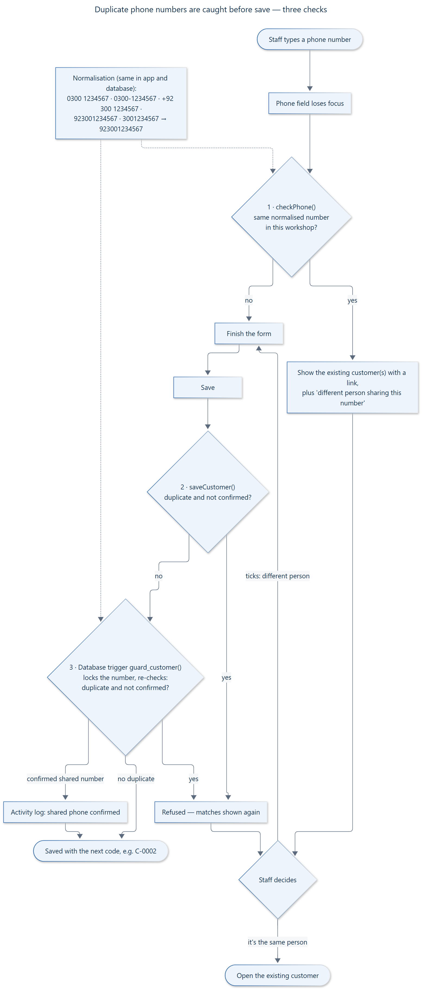

# 06 · Customers

**Phase 2 · Built (job counts and last visit added in Phase 3)**

## What it does

Keeps one record per customer: name, phone, WhatsApp, optional email, address and notes. Staff search
by name, phone or code. Duplicate phone numbers are caught before a second record is created, with an
explicit option for family members who share a number.

## Who can use it

- **Manage:** `customers.manage` — owners and advisors.
- **Read only:** cashiers (for invoices).
- **Archive / restore:** owners only.

## Screens

| Route | Purpose |
| --- | --- |
| `/customers` | Search (name, partial phone in any format, `C-0001`), with vehicles, jobs and last visit columns |
| `/customers/new` | Create; `?then=checkin` makes it step 1 of a check-in |
| `/customers/[id]` | Profile: contact, click-to-WhatsApp, vehicles with mileage and a **New job card** button per active vehicle (for `jobs.manage`), repair history, invoices with what the customer owes |
| `/customers/[id]/edit` | Edit |

## How it works

1. **Normalisation.** The database stores `phone_normalized`, a generated column from
   `normalize_phone()`. `0300 1234567`, `0300-1234567`, `+92 300 1234567`, `923001234567` and
   `3001234567` all become `923001234567`. `src/lib/phone.ts` mirrors this, and a test checks they agree.
2. **On blur.** When the phone field loses focus, `checkPhone()` looks up the normalised number and shows
   any existing customers with links, plus a "different person who shares this number" checkbox.
3. **On save.** `saveCustomer()` refuses if there's a match and the box isn't ticked.
4. **In the database.** Trigger `guard_customer()` takes an advisory lock on the number and checks again,
   so two people saving the same new number at the same moment can't both succeed. A confirmed shared
   number is saved and logged.
5. **Codes.** The trigger assigns `C-0001`, `C-0002`… per workshop, in the same transaction, so a
   refused save doesn't use up a number.

## Rules

- Name required (≤ 120). Phone required, 9–15 digits after normalisation.
- WhatsApp defaults to the phone number; a different number is validated the same way.
- Email optional, must be valid. Notes ≤ 2000 characters, staff-only.
- Changing a customer's phone to a number someone else has is treated exactly like creating one.
- Archived customers are hidden from lists unless "Include archived" is ticked; their history stays.
- Search treats `%`, `_` and `\` as plain text. A term is only matched against phone numbers when it
  looks like a phone number, so `C-0001` finds that customer and not every number containing "01".

## Data

`customers`: `id`, `workshop_id`, `code`, `name`, `phone`, `phone_normalized` (generated), `whatsapp`,
`email`, `address`, `notes`, `shared_phone_confirmed`, `archived_at`, `created_by`, timestamps.
Search: `search_customers(ws, q, include_archived, limit, offset)`, which returns vehicle count, job
count and last visit.

## Security

- RLS by permission (see [roles](03-roles-and-permissions.md)); inventory managers and mechanics can't read customers.
- Clients can't set `code` or move a customer to another workshop (column grants).
- Archiving is owner-only, enforced by the trigger as well as the UI.

## Code

`src/app/(app)/customers/` (pages, `actions.ts`, `customer-form.tsx`), `src/lib/phone.ts`,
`src/lib/record-schemas.ts`, migration `20261115000001_customers_vehicles.sql` (+ search updates in
`20261116000001_job_cards.sql`).

## Tests

`tests/rls/customers-vehicles.test.ts`: the Phase 2 gate (same number in four formats refused;
simultaneous saves let one through; shared numbers need confirmation and are logged), gap-free codes,
client can't choose a code, owner-only archive, search by partial phone and by code, wildcard escaping,
isolation from other workshops. Unit tests: `phone.test.ts`, `record-schemas.test.ts`.

## Not yet built

- Communication history (Phase 6+).
- Merging two customer records (deliberately not automatic, per the PRD).
- Importing customers from a spreadsheet.
