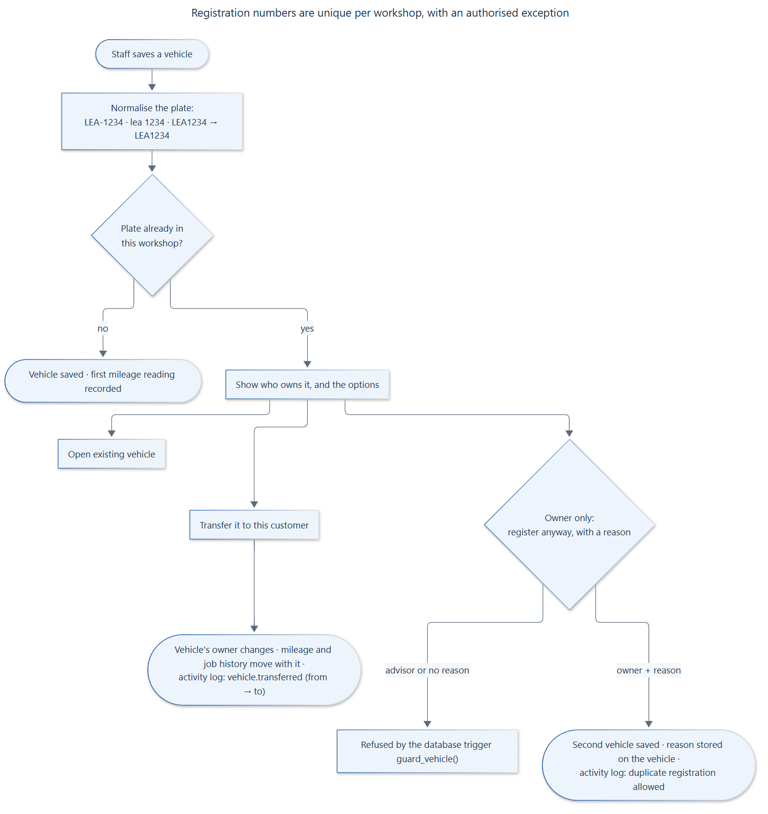

# 07 · Vehicles and mileage history

**Phase 2 · Built (service history added in Phase 3)**

## What it does

Records each customer's vehicles: registration, make, model, variant, year, engine, fuel, transmission,
colour, VIN/chassis and engine numbers. Keeps an append-only odometer history and the vehicle's full
list of job cards. Registration numbers are unique per workshop, and a sold car can be transferred to its
new owner without losing its history.

## Who can use it

- **Manage:** `vehicles.manage` — owners and advisors.
- **Read only:** cashiers.
- **Archive / restore and duplicate-plate override:** owners only.

## Screens

| Route | Purpose |
| --- | --- |
| `/vehicles` | Search by plate (any spacing or case), make or model, owner name or phone |
| `/vehicles/new` | Pick the owner (search), then the vehicle form; `?then=checkin` is check-in step 2 |
| `/vehicles/[id]` | Profile: owner, details, mileage history with "add reading", service history, New job card |
| `/vehicles/[id]/edit` | Edit details (mileage is never edited here) |
| `/vehicles/[id]/transfer` | Choose a new owner and confirm |

## How it works

- **Plates** are normalised (`LEA-1234`, `lea 1234`, `LEA1234` → `LEA1234`) into the generated column
  `registration_normalized`, and saved uppercase as typed.
- **Duplicate plate:** the form shows who owns it and offers **Open existing vehicle**, **Transfer it to
  this customer**, or (owner only) **Register anyway** with a reason. Trigger `guard_vehicle()` enforces
  the owner-plus-reason rule for any client.
- **Transfer** changes `customer_id`. Mileage and job history stay with the vehicle; earlier job cards
  keep the customer they were opened for. The log records from → to.
- **Mileage** readings are append-only (no update or delete grants). Sources: `registration` (first
  reading), `manual`, `job` (check-in). A reading lower than the latest one is refused unless a note
  explains it (trigger `guard_mileage_reading`, serialised per vehicle).
- **Service history** lists every job card for the vehicle, newest first, with date, mileage, complaint
  and status.

## Rules

- Registration: 2–15 letters/digits after normalisation (≤ 20 as typed). Make and model required.
- Year 1950 to next year; engine 50–10,000 cc; fuel: petrol, diesel, CNG, LPG, hybrid, electric, other;
  transmission: manual, automatic, other.
- A vehicle always belongs to a customer **in the same workshop** (composite foreign key).
- Vehicles of archived customers can't get new job cards until restored.

## Data

- `vehicles`: `customer_id`, `registration_number`, `registration_normalized`, `make`, `model`,
  `variant`, `year`, `engine_cc`, `fuel_type`, `transmission`, `colour`, `vin`, `engine_number`,
  `notes`, `duplicate_registration_reason`, `archived_at`.
- `vehicle_mileage_readings`: `vehicle_id`, `reading`, `source`, `note`, `job_card_id`,
  `recorded_by`, `recorded_at`.
- Search: `search_vehicles(ws, q, …)`, which includes the current mileage.

## Code

`src/app/(app)/vehicles/` (pages, `actions.ts`, `vehicle-form.tsx`, `[id]/mileage-form.tsx`,
`[id]/transfer/`), `src/components/customer-picker.tsx`, `src/components/job-history-list.tsx`.

## Tests

`tests/rls/customers-vehicles.test.ts`: duplicate plates in other formats refused; override only for
owner with reason (logged); transfers logged; mileage append-only, lower reading needs a note; search by
plate returns current mileage and owner; a vehicle can't be linked to another workshop's customer.
In the browser: Enter in the duplicate panel never triggers a transfer.

## Not yet built

- Service reminders by date or mileage (Phase 9).
- Vehicle photos outside a job card.
