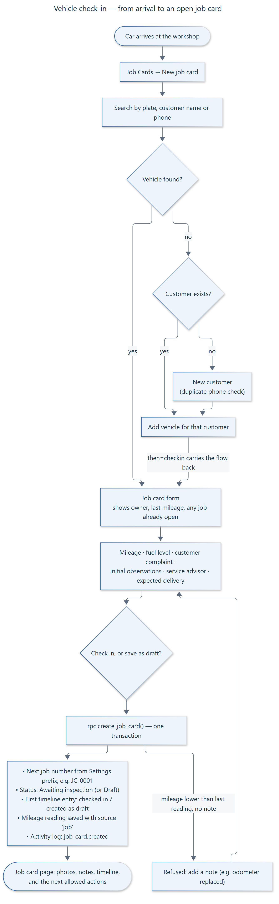
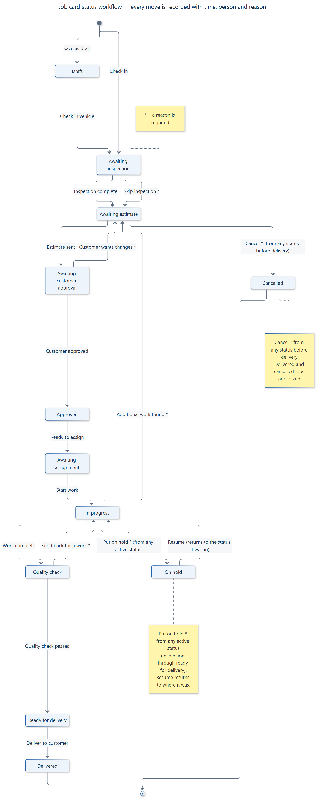
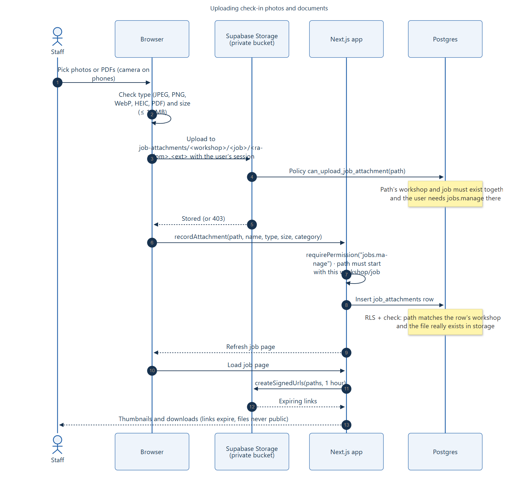

# 08 · Job cards

**Phase 3 · Built** — gate: *every status change is timestamped*

## What it does

A job card is the central record for one visit: the customer's complaint, check-in details, the status
of the work, notes, photos and documents, and a permanent timeline of everything that happened. Later
phases attach inspections, estimates, mechanic tasks, parts, invoices and payments to it.

## Who can use it

- **Open, edit, move, add notes and files:** `jobs.manage` — owners and advisors.
- **Read only:** cashiers (for invoicing later).
- **Mechanics:** don't open `/jobs` (redirected to [My jobs](15-mechanic-my-jobs.md)); they work on
  their assigned tasks from there.

## Screens

| Route | Purpose |
| --- | --- |
| `/jobs` | List with views *In workshop · Drafts · Delivered · Cancelled · All*, status filter (`?status=`), search, overdue badges |
| `/jobs/new` | Check-in: find the vehicle (or customer), then the job card form |
| `/jobs/[id]` | Job card: next allowed actions, details, photos and documents, customer/vehicle panel, WhatsApp, timeline, notes |
| `/jobs/[id]/edit` | Edit complaint, observations, fuel, advisor, expected delivery (not status) |

## Check-in

1. **Find the vehicle** by plate, customer name or phone. Unknown car → *Add vehicle and check in* for
   an existing customer, or *New customer* → vehicle → job card (`then=checkin` carries the flow through).
2. **The form** shows the owner, the last recorded mileage, and a notice if the vehicle already has an
   open job. Fields: complaint (required), odometer, fuel level (empty → full), initial observations,
   service advisor (defaults to you), expected delivery (typed in workshop time).
3. If the odometer is lower than last time, a "why is it lower?" field appears; the database refuses the
   check-in without it.
4. **Check in** (→ *Awaiting inspection*) or **Save as draft** (→ *Draft*). `rpc create_job_card()` does
   everything in one transaction: next job number from the Settings prefix (`JC-0001`), first timeline
   entry, mileage reading tagged with the job, activity log entry. If any part fails, nothing is saved.

## Status workflow

The job card shows only the actions allowed from its current status, defined as data in
`job_status_actions`:

⚙ = system-driven since Phase 4: the move happens when the inspection is completed, an estimate is
sent or revised, or the customer decides. These have no button (`permission = 'system'`, which nobody
holds), so they can't be faked.

| Action | From | To | Reason |
| --- | --- | --- | :-: |
| Check in vehicle | Draft | Awaiting inspection | |
| ⚙ Inspection complete | Awaiting inspection | Awaiting estimate | |
| Skip inspection | Awaiting inspection | Awaiting estimate | required |
| ⚙ Estimate sent to customer | Awaiting estimate | Awaiting approval | |
| ⚙ Customer approved (all or some lines) | Awaiting approval | Approved | |
| ⚙ Customer declined the estimate | Awaiting approval | Awaiting estimate | |
| ⚙ Revise estimate | Awaiting approval, Approved, Awaiting assignment | Awaiting estimate | required |
| Ready to assign | Approved | Awaiting assignment | |
| Start work | Awaiting assignment | In progress | |
| Additional work found | In progress | Awaiting estimate | required |
| Work complete — quality check | In progress | Quality check | |
| Quality check passed | Quality check | Ready for delivery | |
| Send back for rework | Quality check | In progress | required |
| Deliver to customer | Ready for delivery | Delivered | |
| Put on hold | any active status | On hold | required |
| Resume | On hold | the status it was in | |
| Cancel job | any status before delivery | Cancelled | required |

**Skip inspection** exists for quick, fixed-price jobs (e.g. an oil change agreed at the counter). The
reason is recorded so the timeline stays honest. It is a product decision made in Phase 3 and can be
removed by deleting one row of `job_status_actions`.

The job card's **Next step** panel leads with the right screen for the stage: *Start / Continue
inspection*, *Prepare / Continue estimate*, or *Waiting for the customer — view estimate*. *Start
inspection* and *Prepare estimate* act in one click (they start the inspection or the first draft and
open it). See [inspections](10-inspections.md) and [estimates](12-estimates-and-customer-approval.md).
Since Phase 5 the first task a mechanic starts moves an *Approved* or *Awaiting assignment* job to *In
progress* (⚙ *Work started*), and *Work complete — quality check* is refused while any task is open — see
[tasks](14-tasks-and-assignment.md). While an approved job has no tasks yet, **Plan the work** is the
main button (it jumps to the Work card) and *Ready to assign* is shown as a secondary action. While
tasks are open, *Work complete — quality check* isn't offered at all; the panel says how many tasks are
still open instead. The job card's **Work** and **Parts used** cards show the tasks. On the timeline, moves made through the
customer's link show "Customer (approval link)".

## How the gate is enforced

- `status` can't be written by clients (no column grant). The only way to change it is
  `rpc change_job_status(job, action, expected_status, reason)`.
- That function locks the job row, checks the caller's permission, checks the action is allowed from the
  current status, requires a reason where needed, and refuses if `expected_status` is stale
  ("someone else already moved this job"). Two simultaneous clicks therefore produce one move, not two.
- A trigger (`record_job_status_change`) writes **every** status change to `job_status_history` with
  from, to, action, reason, who and `clock_timestamp()`. A guard (`guard_job_card`) rejects any status
  update that didn't come through `change_job_status()`, even from future database code.
- History is append-only: no insert, update or delete grants for clients.
- Delivered and cancelled job cards are locked: details can't be edited and no further moves exist.

## Notes and attachments

- **Notes:** staff-only or customer-visible (shared with customers in a later phase). Append-only; the
  author is always the signed-in user.
- **Photos and documents:** JPEG, PNG, WebP, HEIC and PDF, up to 10 MB each, categorised as vehicle
  photo, existing damage, or document. On phones the picker offers the camera.

Files upload straight from the browser to the private bucket `job-attachments` under
`<workshop>/<job>/<random>.<ext>`. Storage policies check the folder's workshop and job belong together
and the user has `jobs.manage`. The server then records the file. The database checks the path matches
the row's workshop and job and that the file really exists. The page shows thumbnails through signed
links that expire after an hour. "Remove" hides a file but keeps its history; it can't be undone or
hard-deleted from the app.

## Timeline

The job card's timeline merges, oldest first: status changes (with from → to and reason), notes, files
added and files removed, each with the person and time in the workshop's time zone.

## Data

- `job_cards`: `job_number`, `customer_id`, `vehicle_id`, `status`, `status_changed_at`, `on_hold_from`,
  `check_in_at`, `check_in_mileage`, `fuel_level`, `complaint`, `initial_observations`,
  `service_advisor_id`, `expected_delivery_at`, `delivered_at`, `cancelled_at`.
- `job_status_history`: `from_status`, `to_status`, `action`, `reason`, `changed_by`, `changed_at`.
- `job_status_actions`: `code`, `label`, `from_status`, `to_status`, `requires_reason`, `permission`.
- `job_notes`: `body`, `visibility`, `created_by`.
- `job_attachments`: `storage_path`, `file_name`, `content_type`, `size_bytes`, `category`,
  `uploaded_by`, `removed_at`, `removed_by`.
- Functions: `create_job_card`, `change_job_status`, `search_job_cards`, `job_status_counts`.

## Rules

- The job card's customer is the vehicle's owner at check-in; a later transfer doesn't rewrite old jobs.
- The service advisor must be an active member of the workshop.
- Complaint 3–4000 characters; observations ≤ 4000; reasons ≤ 500.
- Expected delivery is entered in workshop time and stored in UTC; it shows *Overdue* once passed.

## Code

`src/app/(app)/jobs/` (list, `new/`, `[id]/` with `status-actions.tsx`, `attachments.tsx`,
`note-form.tsx`, `edit/`, `actions.ts`, `job-form.tsx`), `src/lib/job-status.ts`,
`src/lib/job-schema.ts`, `src/lib/datetime.ts`, `src/lib/staff.ts`, `src/lib/supabase/client.ts`,
migration `20261116000001_job_cards.sql`.

## Tests

`tests/rls/job-cards.test.ts` (21 tests), including:

- **Gate:** check-in is the first timeline entry; a full run from draft to delivered writes exactly one
  ordered, timestamped row per move, by the right person; direct status updates are refused; history
  can't be edited, deleted or forged.
- Invalid moves refused; reasons required; resume returns to the previous status; two simultaneous
  clicks → one move; closed jobs locked.
- Check-in is atomic (a refused mileage leaves no job); job numbers use the current prefix; advisors
  must belong to the workshop.
- Mechanics and other workshops can't read or move jobs; cashiers read only; notes can't be forged.
- Attachments: private, readable by staff of that workshop only; uploads into another workshop's
  folder refused; records for missing or mismatched files refused; removal is permanent and attributed.

Unit tests: `job-schema.test.ts`, `datetime.test.ts`. The full check-in chain, skip inspection, photo
upload, notes, hold and resume, dashboard counts and search were verified in the browser.

## Not yet built

- Invoices and payments (Phase 6), parts used (Phase 7).
- Printable job card / PDF.
