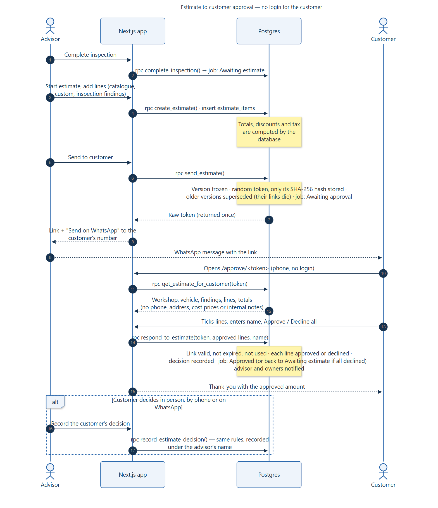
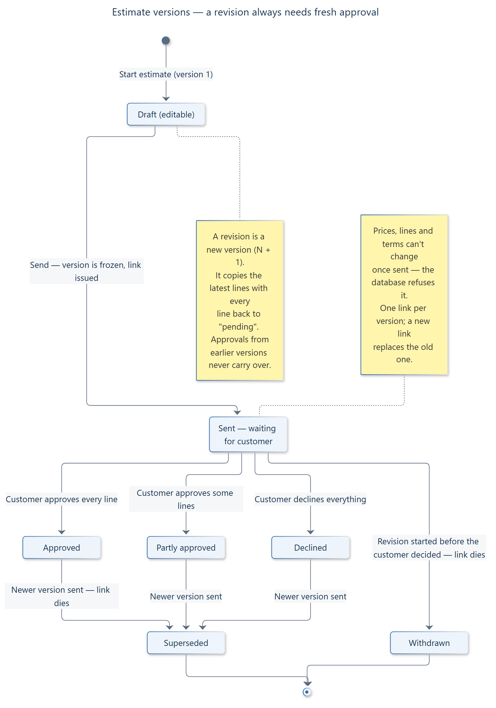
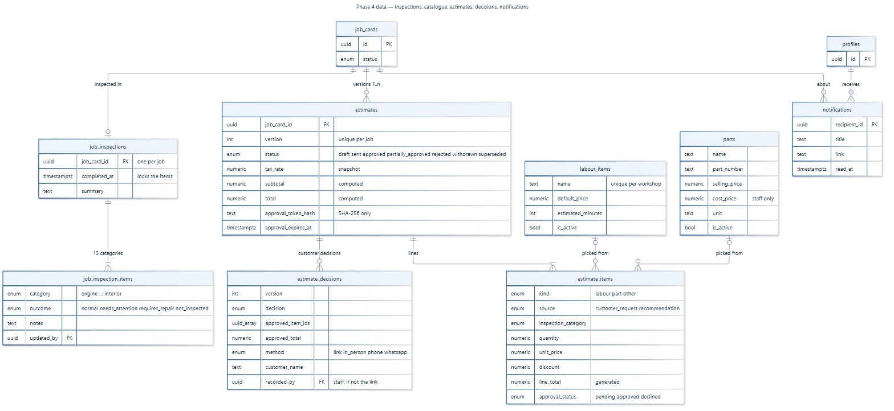

# 12 · Estimates and customer approval

**Phase 4 · Built** — gate: *a revised estimate needs fresh approval*

## What it does

Advisors build an estimate for a job from the catalogue, custom lines and inspection findings, then send
the customer a secure link (usually on WhatsApp). The customer approves or declines each line on their
phone with no login. Every change after sending is a new **version** that the customer must approve
again. Approvals never carry over.

## Who can use it

- **Prepare, send, revise, record decisions:** `estimates.manage` — owners and advisors.
- **Read:** anyone who can read job cards; cashiers (for invoicing later).
- **Customer:** anyone holding a valid link, without an account.

## Screens

| Route | Purpose |
| --- | --- |
| `/jobs/[id]/estimate` | Editor (draft), waiting state, decided state, version history (`?v=N`) |
| `/approve/[token]` | The customer's approval page (public, not indexed by search engines) |
| `/estimates` | All estimates: *Waiting for customer · Drafts · Decided* |
| Job card | "Prepare / Continue estimate" next step; estimate summary card |

## How it works

1. **Start.** Once the job is *Awaiting estimate* (inspection completed or skipped),
   `rpc create_estimate(job)` creates version 1 as a draft, snapshotting the workshop's tax label and rate.
2. **Lines.** Each line is labour, part or other, and either *customer request* or *our recommendation*
   (optionally tied to an inspection category). It has quantity, unit price, a discount amount and a
   taxable flag. Lines come from the catalogue, are typed in, or are added from inspection findings with
   one click (priced afterwards with **Edit**).
3. **Totals** are computed **by the database** (generated `line_total`; trigger recalculates subtotal,
   discounts, tax on taxable lines only, total), so the UI can't get them wrong.
4. **Send.** `rpc send_estimate(estimate, valid_days)` freezes the version, issues a 256-bit random
   token (only its SHA-256 hash is stored), supersedes all earlier versions (their links die), and moves
   the job to *Awaiting approval*. The link is shown once, with **Copy** and **Send on WhatsApp**
   (pre-addressed to the customer's WhatsApp number). **Get a new link** replaces a lost one.
5. **Customer decides** on `/approve/<token>`: they see what they reported, the inspection findings, each
   line marked "recommended after inspection" or "you asked for this", a live total of the ticked lines,
   and terms. They enter their name and press **Approve** or **Decline all**.
   `rpc respond_to_estimate()` marks each line approved or declined, records the decision, moves the job
   (*Approved* if anything was approved, back to *Awaiting estimate* if everything was declined), and
   notifies the service advisor and owners.
6. **In person / by phone / on WhatsApp.** Staff use **Record the customer's decision** on the estimate
   page. The same rules apply, recorded under their name with the method and an optional note. If
   signed-in staff open the customer's link, the page warns them that a decision there is recorded under
   their own name.
7. **Revise.** **Revise estimate** creates version N + 1 copying the latest lines, **every line back to
   pending**. If the customer had approved, or the job had moved on to *Approved* or *Awaiting
   assignment*, a reason is required and the job returns to *Awaiting estimate*. If the previous version
   was still waiting, it's withdrawn and its link dies. During *In progress*, use **Additional work
   found** on the job card first.

## How the gate is enforced (in the database)

- Lines of a sent version can't be added, changed or removed, and its terms can't change
  (triggers `guard_estimate_item`, `guard_estimate`): "estimate_locked".
- `approval_status` isn't writable by clients; only the decision functions set it.
- A revision always starts with pending lines; only one draft and one waiting version per job.
- Sending a new version marks every earlier version *superseded* and clears its token, so an old link
  can neither show nor approve anything.
- A link works once; expired, withdrawn or superseded links are refused.

## Rules

- Quantity > 0 (up to 2 decimals); prices and discounts ≥ 0 with up to 2 decimals; a discount can't
  exceed the line amount.
- Sending needs at least one line and the job in *Awaiting estimate*.
- Links last 3, 7, 14 or 30 days (1–60 allowed by the database).
- The customer's name is required on the link (≥ 2 characters).
- Money is `numeric`, shown as e.g. "Rs 13,000" (paisa only when present).

## Data

- `estimates`: `version`, `status`, tax snapshot, computed totals, `estimated_completion`, `terms`,
  `customer_note`, `approval_token_hash`, `approval_expires_at`, `sent_at`, `decided_at`, `closed_at`.
- `estimate_items`: `kind`, `source`, `inspection_category`, `description`, `labour_item_id`/`part_id`,
  `quantity`, `unit_price`, `discount`, `taxable`, `line_total` (generated), `approval_status`.
- `estimate_decisions` (append-only): version, decision, approved and declined line ids,
  `approved_total`, `method`, `customer_name`, `note`, `recorded_by`.
- Functions: `create_estimate`, `send_estimate`, `renew_estimate_link`, `respond_to_estimate` (public),
  `record_estimate_decision`, `get_estimate_for_customer` (public).

## Security

- The customer page gets data only through `get_estimate_for_customer(token)`: workshop name and phone,
  vehicle, customer's **first name**, complaint, findings, lines and totals. No customer phone, email or
  address, no cost prices, no internal notes. Signed-out visitors have no direct table access.
- Tokens are 256-bit random; only hashes are stored; links expire and are single-use.
- All staff functions check `estimates.manage` in the job's workshop and answer "not found" for other
  workshops' records.

## Code

`src/app/(app)/jobs/[id]/estimate/` (page, `estimate-forms.tsx`, `actions.ts`), `src/app/approve/[token]/`,
`src/app/(app)/estimates/page.tsx`, `src/lib/estimates.ts`, `src/lib/money.ts`.

## Tests

`tests/rls/estimates.test.ts` (17 tests), including:

- **Gate:** v1 approved → revision required with a reason → v2 lines all pending → sending v2
  supersedes v1 → v1's link can't approve or even display → a fresh, partial decision on v2 → two
  separate decision records.
- Sent versions frozen (price, delete, add, terms); staff can't set approval status; revising a waiting
  version withdraws it; links single-use; declining all returns the job; name required; foreign line ids
  refused; staff decisions attributed; notifications go to advisor and owners but not the person acting.
- Totals with discounts and partial tax: 2 × 1,000 − 100 (taxable) + 500 (not taxable) at 17% → 2,723.
- One draft at a time; no estimate before inspection; no empty sends.
- The customer page exposes no contact details or cost prices; full isolation from other workshops.

In the browser: inspection → estimate from catalogue and findings → send → customer partial approval on
a phone-width screen → notification → revision → old link dead → phone approval recorded by staff.

## Not yet built

- PDF estimate (P1 in the PRD; PDFs arrive with invoices).
- Automatic WhatsApp sending and reminders (needs the official WhatsApp Business API).
- Urdu version of the customer page.
