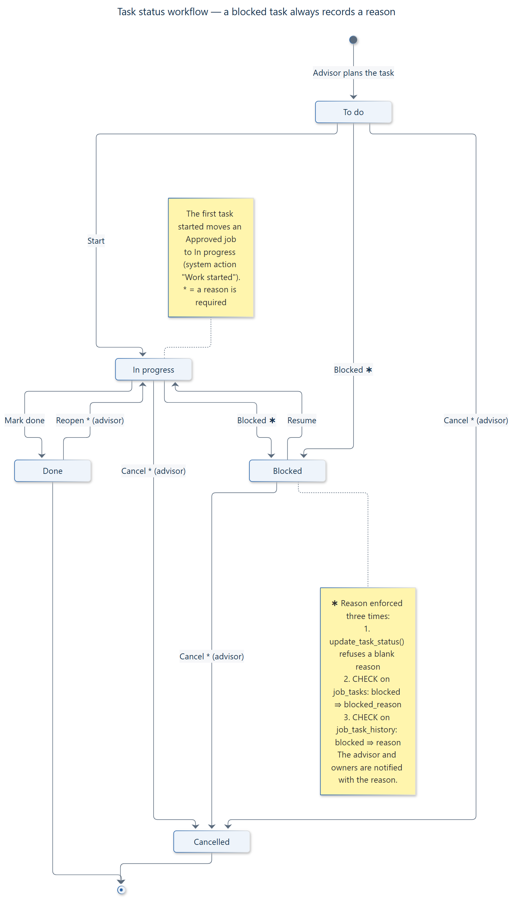
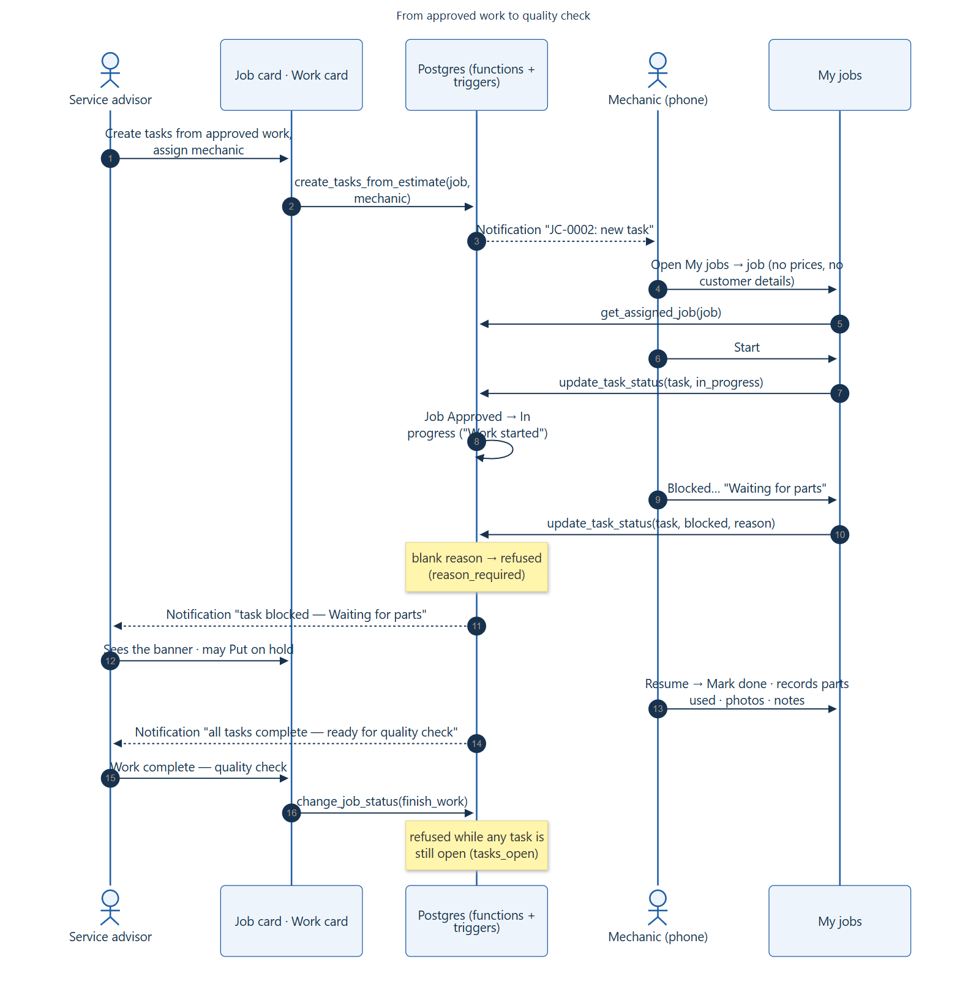
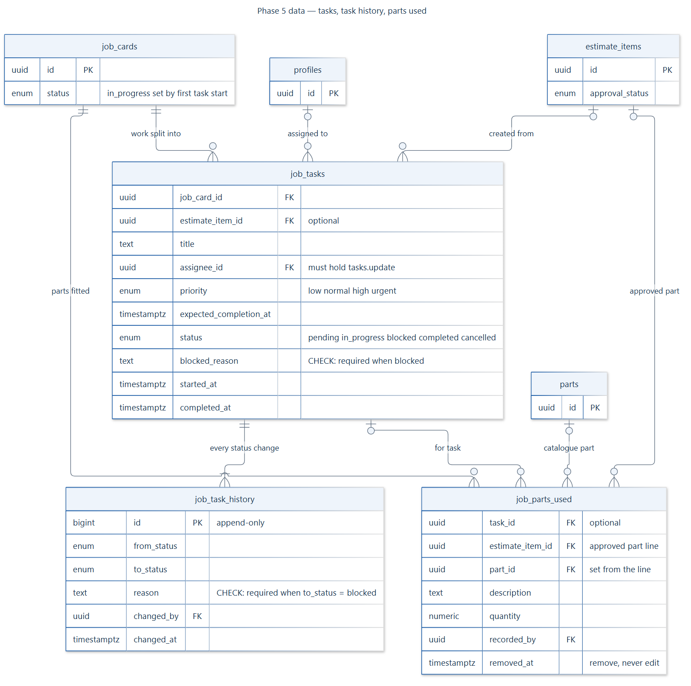

# 14 · Tasks and mechanic assignment

**Phase 5 · Built** — gate: *a blocked task always records a reason*

## What it does

Once the customer has approved the work, the service advisor splits it into **tasks** and assigns each
one to a mechanic, with a priority and an expected finish time. Mechanics start, block and complete
their tasks from their phone ([My jobs](15-mechanic-my-jobs.md)). The advisor sees progress, blocked
work and its reasons on the job card, and the job moves forward on its own when work starts.

## Who can use it

- **Plan, edit, reassign, cancel and reopen tasks:** `jobs.manage` (owners, advisors).
- **Start, block, resume and complete a task:** the assigned person (they need `tasks.update`), or anyone
  with `jobs.manage`.
- **Be assigned:** active members with `tasks.update` (mechanics and owners, or anyone given it as an
  extra permission). Mechanics are listed first.
- **Read tasks:** `jobs.manage`, `invoices.manage`, `payments.record`, and mechanics on jobs where they
  have a task.

## Screens

| Where | What |
| --- | --- |
| Job card → **Work** card | Progress ("1 of 2 tasks done"), blocked-task banner with reasons, "all tasks done" prompt, **Create tasks** from approved work, task list with status buttons, **Edit or reassign**, **+ Add a task** |
| Job card → **Timeline** | Every task change ("Task blocked: Skim front rotors — Waiting for parts") alongside status moves and notes |
| [`/my-jobs/[id]`](15-mechanic-my-jobs.md) | The mechanic's version of the same task list, with large buttons |

## How it works

1. **Plan.** On an *Approved*, *Awaiting assignment*, *In progress* or *On hold* job, the advisor either
   presses **Create tasks** (one task per approved labour / other line, assigned to the chosen mechanic,
   `rpc create_tasks_from_estimate`) or adds tasks by hand (title, mechanic, priority, expected time,
   instructions). Lines that already have a task, including a cancelled one, aren't offered again.
2. **Assign.** The mechanic gets a notification ("JC-0002: new task") that opens their job view.
   Reassigning notifies the new mechanic.
3. **Work.** Every status change goes through `rpc update_task_status(task, to, expected, reason)`:

   | From | To | Who | Reason |
   | --- | --- | --- | --- |
   | To do | In progress (**Start**) | assignee or advisor | — |
   | To do / In progress | Blocked | assignee or advisor | **required** |
   | Blocked | In progress (**Resume**) | assignee or advisor | — |
   | In progress | Done (**Mark done**) | assignee or advisor | — |
   | Done | In progress (**Reopen**) | advisor | required |
   | To do / In progress / Blocked | Cancelled | advisor | required |

4. **The job follows.** Starting the first task on an *Approved* or *Awaiting assignment* job moves the
   job to *In progress* (system action **Work started**, reason "Bilal Khan started 'Brake service'").
   The manual **Start work** button still exists for jobs without tasks.
5. **Blocked.** The task shows "Blocked since 12:10 pm: Waiting for parts"; the advisor and owners are
   notified with the reason; the job card shows a banner suggesting **Put on hold** if the job can't
   continue. Mechanics pick from quick reasons (waiting for parts / customer / another mechanic / tools)
   or type their own.
6. **Finished.** When the last open task is completed or cancelled, the advisor and owners get "all tasks
   complete — ready for quality check", and the Work card says so. The job does **not** advance by
   itself: the advisor presses **Work complete — quality check**, which is refused while any task is still
   open.

## Rules

- **Gate:** a task can never be *Blocked* without a reason. Enforced three times: `update_task_status`
  refuses an empty or blank reason; a CHECK constraint on `job_tasks` refuses a blocked row with no
  reason; a CHECK constraint on `job_task_history` refuses a history entry for a block with no reason.
- Task status can only change through `update_task_status` (status isn't a writable column, and a guard
  trigger rejects any other change, even with full database rights).
- Every change is written to the append-only `job_task_history` with time, person and reason.
- A task needs an assignee before it can start, block or complete.
- Tasks are planned and moved only while the job is *Approved*, *Awaiting assignment*, *In progress* or
  *On hold*. From quality check on they are read-only; **Send back for rework** reopens the job for work.
- On an *On hold* job tasks can be blocked or completed but not started or resumed.
- A job can't move to *Quality check* while any task is open (trigger `guard_job_work_finished`).
- Stale screens are caught: each move carries the status the person saw (`status_changed`).
- Done and cancelled tasks can't be edited; reopen first. The approved line a task came from can't change.

## Data

- `job_tasks`: `job_card_id`, `estimate_item_id` (optional link to the approved line), `position`,
  `title`, `description`, `assignee_id`, `priority` (`low`, `normal`, `high`, `urgent`),
  `expected_completion_at`, `status` (`pending`, `in_progress`, `blocked`, `completed`, `cancelled`),
  `blocked_reason`, `blocked_at`, `started_at`, `completed_at`, `status_changed_at`, `created_by`.
- `job_task_history` (append-only): `task_id`, `job_card_id`, `from_status`, `to_status`, `reason`,
  `changed_by`, `changed_at`.
- Activity log: `task.created`, `task.status_changed`, `task.reassigned` on the job card.

## Security

- Clients may insert and update task details only with `jobs.manage`, and only the columns `title`,
  `description`, `assignee_id`, `priority`, `expected_completion_at`, `position`.
- The assignee must be an active member of the same workshop with `tasks.update`.
- `update_task_status` answers "Task not found" for tasks in other workshops, and refuses other mechanics'
  tasks.
- Composite foreign keys keep tasks and history inside the job's workshop.

## Code

- Migration `20261118000001_mechanic_tasks.sql`.
- `src/lib/tasks.ts` (labels, `taskMoves()` — mirrors the database rules, schemas, error messages),
  `src/lib/work.ts` (loads tasks, parts used and task history for a job).
- `src/app/(app)/jobs/task-actions.ts` (server actions), `src/app/(app)/jobs/[id]/work-panel.tsx`,
  `work-forms.tsx`.
- `src/components/tasks/` — `task-list.tsx`, `task-status-buttons.tsx`, `task-form.tsx`, `parts-used.tsx`.

## Tests

`tests/rls/tasks.test.ts`:

- **Gate** — "refuses to block a task without a reason" (missing, empty and whitespace reasons, from
  *To do* and *In progress*); "can't be bypassed by writing the status directly" (no column grant; guard
  trigger even for the service role; both CHECK constraints); "keeps every block and its reason in the
  task history"; "tells the advisor what is blocking the work".
- Workflow — first task moves the job to *In progress*; quality check refused while tasks are open;
  only the assignee or an advisor moves a task, only advisors cancel or reopen; stale and invalid moves
  refused; assignees must be able to update tasks; no tasks before approval; create-from-estimate runs
  once and skips cancelled work; the mechanic is notified.

`src/lib/tasks.test.ts` — the moves each person is offered and the form schemas.

## Not yet built

- Time tracking per task (start/stop timer, labour hours for payroll).
- Assigning one task to several mechanics.
- A workshop-wide workload board ("who's busy").
- Automatic quality-check checklists (Phase 6+ if customers ask).
