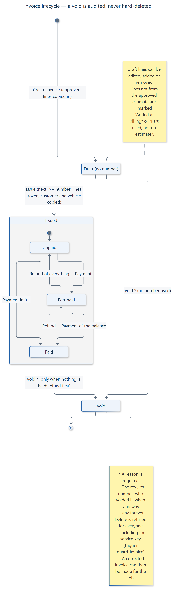
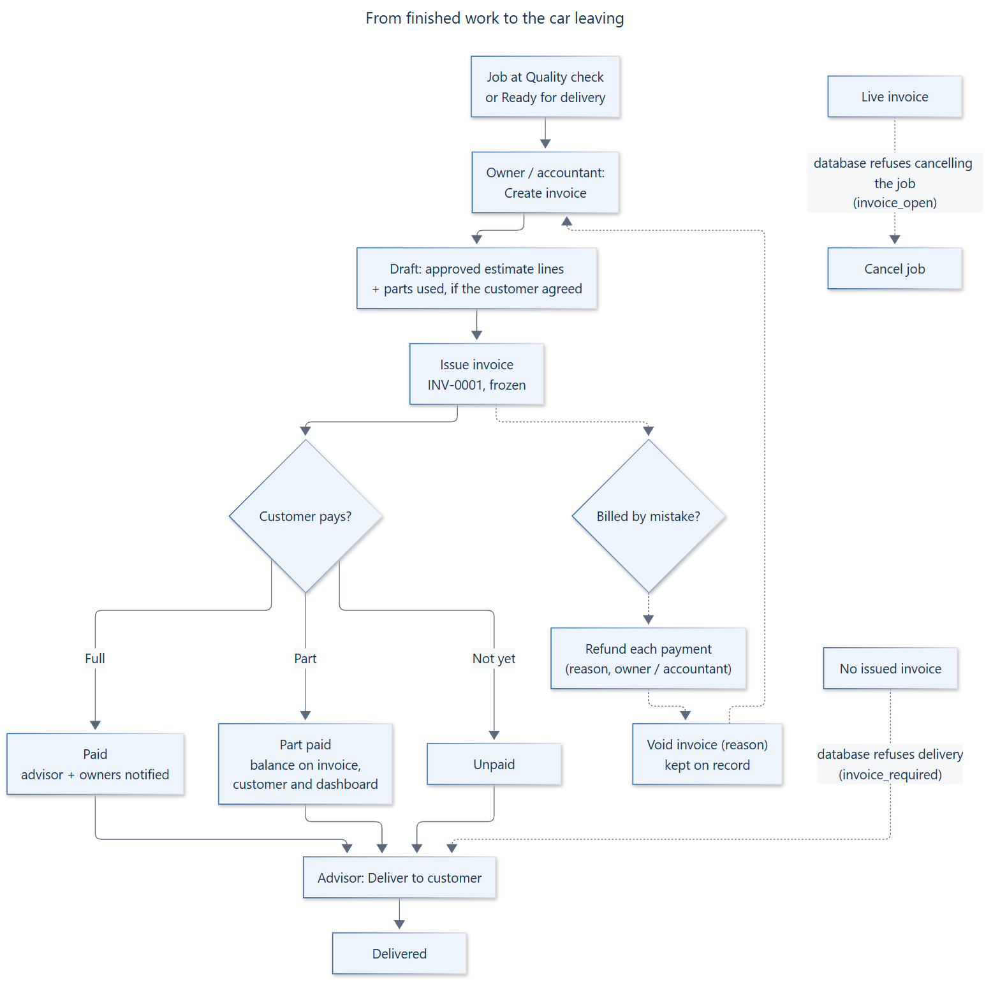
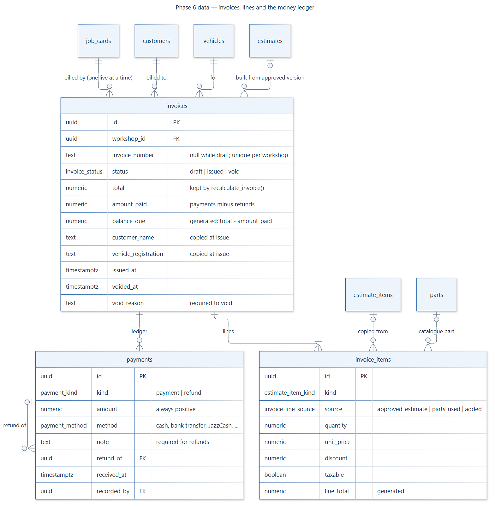

# 17 · Invoices, payments, refunds and void

**Phase 6 · Built**

## What it does

Turns finished work into an invoice, takes full or part payments, gives money back with a recorded
reason, and voids invoices that should never have been billed — without ever deleting anything. Each
invoice can be downloaded as a PDF or summarised to the customer on WhatsApp.

**Phase 6 gate — a void is audited, never hard-deleted.** Deleting an invoice is refused for every
user, including the database's service key. Voiding keeps the invoice, its number, who voided it,
when and why, and writes an activity-log entry.

## Who can use it

| Action | Permission | Roles by default |
| --- | --- | --- |
| See invoices, lines and payments | `invoices.manage`, `payments.record` or `jobs.manage` | Owner, accountant/cashier, service advisor (read-only) |
| Create, edit and issue invoices; void; refund | `invoices.manage` | Owner, accountant/cashier |
| Record payments | `payments.record` | Owner, accountant/cashier |

Mechanics and inventory managers see no billing at all. An owner can grant `invoices.manage` or
`payments.record` to an advisor as an extra permission (see [roles](03-roles-and-permissions.md)).

## Screens

| Route | Purpose |
| --- | --- |
| `/invoices` | **Ready to bill** (finished jobs with no invoice, with *Create invoice*), then tabs *Unpaid · Drafts · Paid · Void · All*, search by invoice number, customer or registration, and the total outstanding |
| `/invoices/[id]` | The invoice: lines, totals, payments ledger, *Record a payment*, *Refund…* per payment, *Issue*, notes, *Void* |
| `/invoices/[id]/pdf` | The invoice as an A4 PDF (a draft is stamped DRAFT, a void one VOID) |
| Job card | An **Invoice** summary; the Next step offers *Create invoice* / *Finish and issue the invoice*; money events on the timeline |
| Customer profile | The customer's invoices and what they owe |
| Dashboard | **Money today**: invoiced today, collected today, outstanding — three separate numbers |

## How it works

1. **Create.** When a job reaches *Quality check* or *Ready for delivery*, `rpc create_invoice(job)`
   makes a draft from the approved lines of the latest approved estimate version, at that estimate's
   tax rate. Drafts have no number yet.
2. **Check the draft.** Lines can be edited, removed or added. Extra lines are marked *Added at
   billing*. Parts the mechanics recorded that weren't on the approved estimate are listed with a
   one-tap *Add to invoice* (price from the parts catalogue), marked *Part used, not on estimate*.
   Notes (e.g. warranty terms) print on the invoice.
3. **Issue.** `rpc issue_invoice(invoice)` gives it the next number (`INV-0001`, using the workshop's
   prefix), freezes its lines and copies the customer's name and phone, the plate, the vehicle and the
   odometer onto it, so a reprint always shows what the customer was given.
4. **Get paid.** `rpc record_payment(invoice, amount, method, reference, note)`: cash, bank transfer,
   JazzCash, Easypaisa, card, cheque or other. The form fills in the full balance; change it for a
   part payment. More than the balance due is refused. When the balance reaches zero, the job's
   advisor and the owners get a "paid in full" notification.
5. **Deliver.** The advisor can deliver once the invoice is issued — paid or not, since credit
   customers are common. The delivery button asks for confirmation and says what is still owed.
6. **Give money back.** `rpc refund_payment(payment, amount, method, reason)` on one payment, up to what
   is left of it. The invoice stays issued and owes that amount again. Also used to correct a payment
   entered by mistake.
7. **Void.** `rpc void_invoice(invoice, reason)` — only while no money is held on it (refund first).
   A corrected invoice can then be created for the same job.

## Rules

- One live (draft or issued) invoice per job; voided ones don't count.
- Invoices are made only at *Quality check*, *Ready for delivery* or *Delivered* (`invoice_not_allowed`).
- An invoice needs at least one line to be issued (`invoice_empty`).
- Issued and void invoices can't be changed at all (`invoice_locked`); a draft's money columns are never
  client-writable either — totals are computed in the database (`recalculate_invoice`).
- A job can't be **delivered** without an issued invoice (`invoice_required`), and can't be
  **cancelled** while it has a draft or issued invoice (`invoice_open`). The job card hides those buttons
  and explains why instead.
- Payments and refunds are an append-only ledger: rows are never updated or deleted, for anyone
  (`payment_permanent`). `amount_paid` on the invoice is payments minus refunds; `balance_due` is
  `total − amount_paid`, generated by the database.
- A refund always has a reason and can't exceed what is left of its payment (`refund_too_large`); a
  refund can't be refunded.
- A void always has a reason and is refused while money is held (`invoice_has_payments`).
- Void vs refund (build plan): void = *this should never have been billed*; refund = *it was billed
  correctly, money is going back*.
- The dashboard shows invoiced and collected separately and never adds them together (PRD).

## Data

- `invoices`: job, customer, vehicle, the estimate it came from, `invoice_number`, `status`
  (`draft · issued · void`), tax label and rate, `subtotal`, `discount_total`, `tax_total`, `total`,
  `amount_paid`, `balance_due` (generated), `notes`, the copied customer and vehicle fields,
  `issued_at/by`, `voided_at/by`, `void_reason`.
- `invoice_items`: `kind`, `source` (`approved_estimate · parts_used · added`), description, part,
  quantity, unit price, discount, taxable, generated `line_total`.
- `payments`: `kind` (`payment · refund`), positive `amount`, `method`, `reference`, `note` (the
  refund reason), `refund_of`, `received_at`, `recorded_by`.
- `billing_summary(ws, from, to)` returns invoiced, invoice count, collected (payments − refunds),
  outstanding and unpaid count for the dashboard.

## Security

- Row-level security on all three tables; every reference carries `workshop_id`, so a line, payment
  or refund can't point at another workshop's rows.
- Status, numbers, totals and money change only inside the checked functions (transaction flag
  `workshopos.invoice_system`); triggers `guard_invoice`, `guard_invoice_item` and `guard_payment`
  refuse everything else.
- No delete grant on invoices or payments; the triggers refuse deletes even for the service key.
- The PDF route reads through the same row-level security, so another workshop's invoice is a 404.

## Code

`supabase/migrations/20261120000001_invoices_payments.sql`, `src/lib/invoices.ts` (labels, schemas,
messages), `src/lib/billing.ts` (loading an invoice), `src/lib/invoice-pdf.ts` (PDF, `pdf-lib`),
`src/app/(app)/invoices/` (list, invoice page, forms, actions, PDF route).

## Tests

- `tests/rls/invoices.test.ts` (19 tests): the gate (delete refused for everyone; void keeps number,
  person and reason and logs it; void refused while money is held), building drafts from approved
  lines with the estimate's tax, numbering and freezing on issue, part payments, overpayment, the
  append-only ledger, refund limits and reasons, "paid in full" notifications, the dashboard sums,
  delivery and cancellation rules, advisors read-only, mechanics and other workshops shut out.
- `src/lib/invoices.test.ts`, `src/lib/invoice-pdf.test.ts`: payment states, form parsing, error
  wording, WhatsApp text; the PDF is valid, flows onto more pages and survives text the fonts can't draw.

## Not yet built

- Advance payments or deposits before an invoice exists (waiting for pilot demand).
- Urdu text on PDFs: the standard PDF fonts can't draw it, so it prints as "?". Needs an embedded
  font with Urdu shaping.
- Sending the PDF itself on WhatsApp (needs the WhatsApp Business Platform; click-to-WhatsApp can
  only send text).
- Estimate PDFs, credit notes, and daily cash-up / end-of-day reports (Phase 9 reporting).
