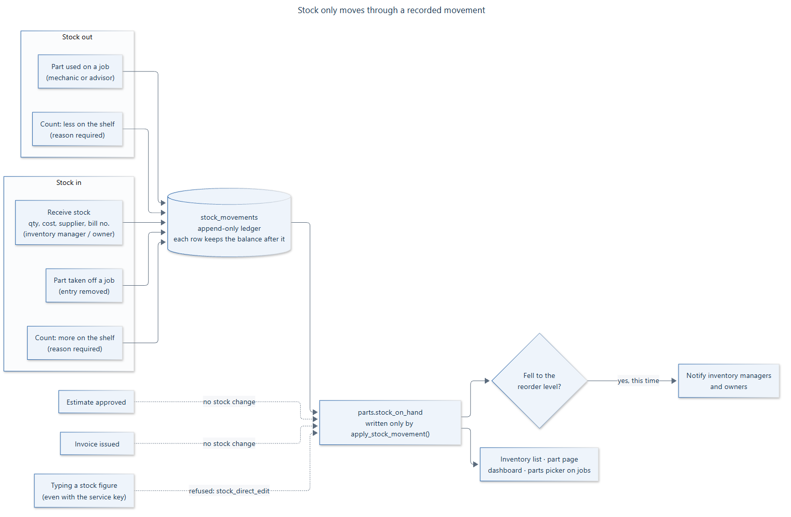
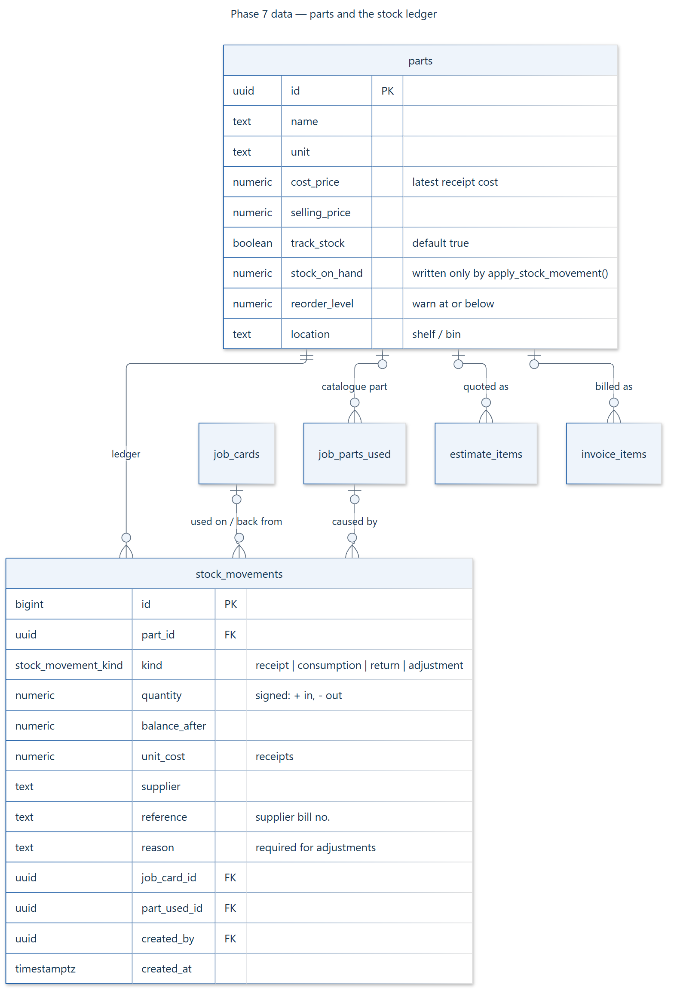

# 18 · Inventory

**Phase 7 · Built**

## What it does

Keeps a live stock figure for every catalogue part, warns before parts run out, and shows exactly why
the figure is what it is. Stock comes in by receiving deliveries, goes out when a part is used on a
job, comes back when that entry is removed, and is corrected by counting the shelf.

**Phase 7 gate — stock only moves through a recorded movement.** Nobody can type a stock figure, not
even with the database's service key. On jobs, stock moves only when a part is actually used — never
when it is estimated, approved or invoiced.

## Who can use it

| Action | Permission | Roles by default |
| --- | --- | --- |
| Inventory screens, movements ledger, receive, count, stock settings | `inventory.manage` | Owner, inventory manager |
| Add and edit parts (name, prices, unit, supplier) | `inventory.manage` or `workshop.settings` | Owner, inventory manager |
| See stock figures in the job's parts picker | `estimates.manage` (reads the catalogue) | Owner, service advisor |
| Use parts on a job (moves stock) | as in [parts used](16-parts-used.md) | Advisors; mechanics on their jobs |

Mechanics never see the catalogue or stock figures; the parts they record still move stock.

## Screens

| Route | Purpose |
| --- | --- |
| `/inventory` | Parts tracked, how many are low or out, stock value at cost; tabs *All parts · Low or out · Not tracked*; search by name, part number, brand or shelf; *Add a part* |
| `/inventory/[id]` | On hand, cost and selling price, value; the **movements ledger** (what, who, when, change, balance after); *Receive stock*; *Count stock*; stock settings (track stock, reorder level, shelf); *Edit part details* |
| Job card → Parts used | Approved parts show "12 set in stock"; advisors can also pick any stocked catalogue part that wasn't on the estimate |
| Dashboard | **Stock to reorder** for owners and inventory managers: parts at or below their reorder level, or at zero or below |
| Labour and parts catalogue | Each tracked part links to its stock page |

## How it works

1. **Opening stock.** New parts start at zero. *Count stock* with a reason such as "Opening stock"
   sets the real figure; the difference is recorded as a count correction.
2. **Receiving.** `rpc receive_stock(part, quantity, unit_cost, supplier, reference)` adds stock. A
   cost given here becomes the part's cost price, so stock value and margins follow real purchase prices.
3. **Using parts.** When a part-used entry with a catalogue part is recorded on a job (approved estimate
   line, or a catalogue part picked by an advisor), a trigger records a *Used on job* movement for that
   quantity. Removing the entry records *Back from job* with "Removed from JC-…". Parts described in free
   text ("Something else") have no catalogue part and don't move stock.
4. **Counting.** `rpc count_stock(part, counted, reason)` sets stock to what is on the shelf. A count
   that matches records the check in the activity log and moves nothing.
5. **Low stock.** Every movement goes through `apply_stock_movement()`, which writes the ledger row with
   the balance after it and updates the part's figure. When stock falls to or below the reorder level
   *on that movement*, owners and inventory managers get a "Low stock" notification (not the person who
   used the part). A part already low doesn't notify again until it has been restocked above the level.

## Rules

- Stock can go below zero. A mechanic can fit a part before the delivery has been received in the
  system; refusing would stop work at the bay. The part then shows *Below zero* in red until stock is
  received or counted.
- Receipts and counts need stock tracking on for the part (`stock_not_tracked`). Untracked parts
  (consumables like rags) never move stock.
- Quantities: above zero for receipts, zero or more for counts, at most two decimals.
- A count always needs a reason (`reason_required`).
- Ledger rows are never updated or deleted, for anyone (`stock_permanent`); mistakes are corrected by
  counting.
- `stock_on_hand` is not client-writable, and a trigger refuses any change outside
  `apply_stock_movement()` (`stock_direct_edit`); a new part always starts at zero.
- Approving an estimate, issuing an invoice or delivering a job moves no stock.

## Data

- `parts` gains `track_stock` (default on), `stock_on_hand`, `reorder_level`, `location`.
- `stock_movements`: `kind` (`receipt · consumption · return · adjustment`), signed `quantity`,
  `balance_after`, `unit_cost`, `supplier`, `reference`, `reason`, `job_card_id`, `part_used_id`,
  `created_by`, `created_at`.
- `low_stock_parts(ws)` lists parts at or below their reorder level for the dashboard and list.

## Security

- Row-level security: only `inventory.manage` reads the ledger; every reference carries `workshop_id`.
- No insert, update or delete grants on `stock_movements`; the only writer is the internal
  `apply_stock_movement()`, called by `receive_stock`, `count_stock` and the parts-used trigger.
- Another workshop's parts are "Part not found" to every function.

## Code

`supabase/migrations/20261121000001_inventory.sql`, `src/lib/inventory.ts`,
`src/app/(app)/inventory/` (list, part page, forms, actions), `src/components/tasks/parts-used.tsx`
(stock in the picker), `src/app/(app)/dashboard/page.tsx` (stock to reorder).

## Tests

- `tests/rls/inventory.test.ts` (10 tests): the gate (direct edits refused even for the service key, new
  parts start at zero, the ledger is append-only, estimates / approvals / invoices move nothing, using a
  part does, removing it returns it), stock below zero, untracked parts, receipts updating cost, counts
  with reasons, low-stock notifications once on crossing, roles, other workshops.
- `src/lib/inventory.test.ts`: stock levels, form parsing, quantity formatting.

## Not yet built

- Purchase orders and supplier price lists (deferred in the build plan).
- Stock reports over time and a stock-take sheet (Phase 9 reporting).
- Moving stock between branches (multi-branch is deferred).
